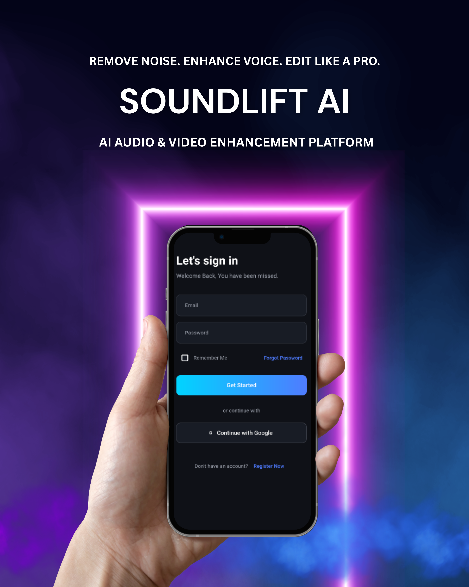
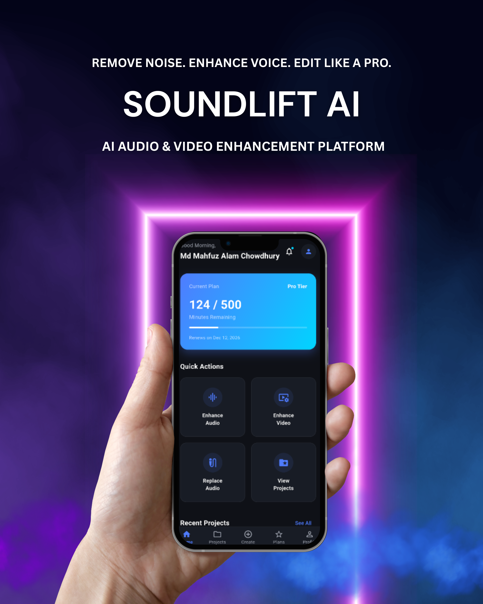
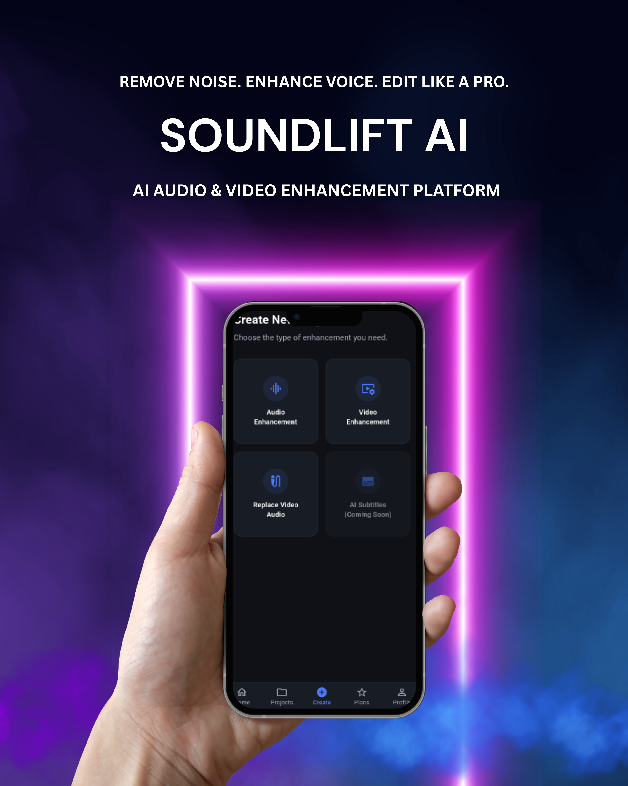
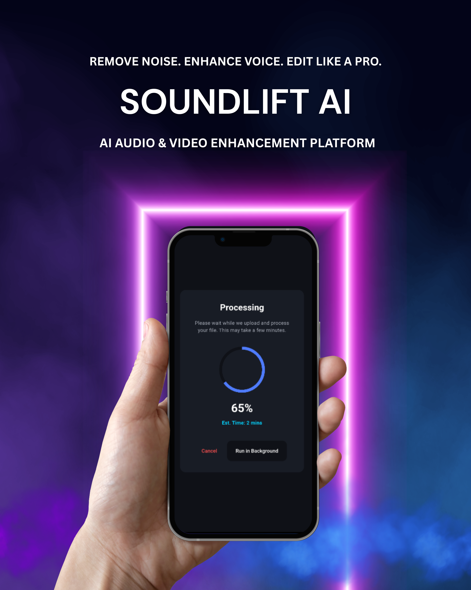
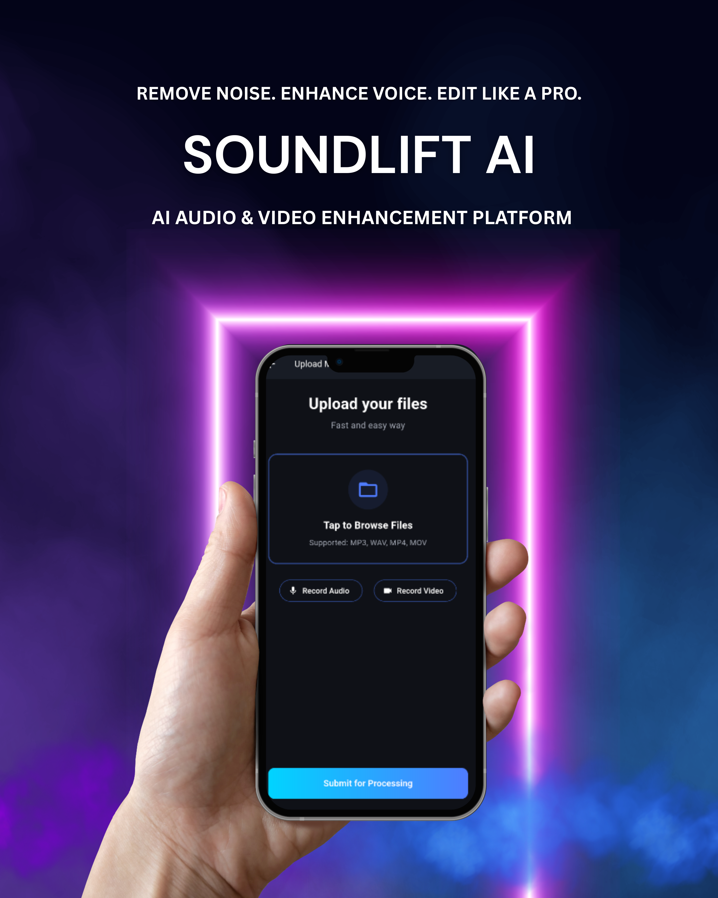
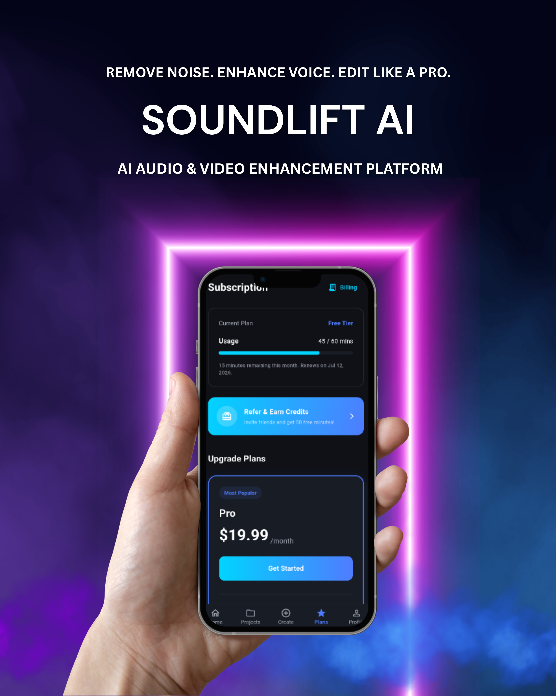
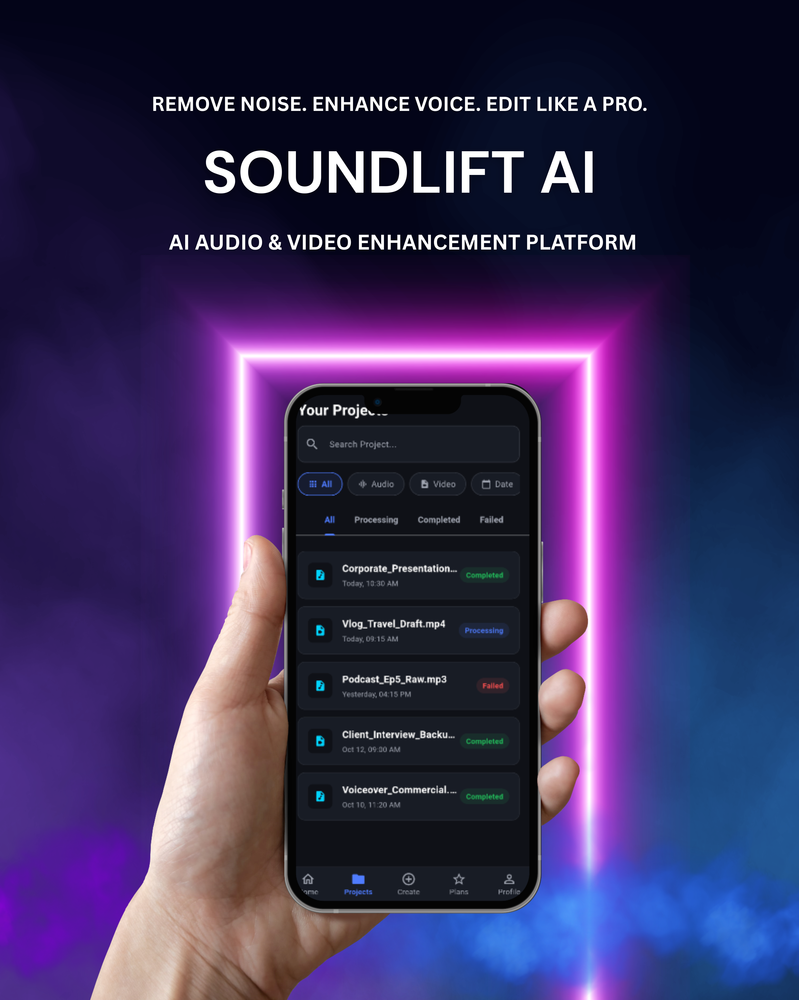
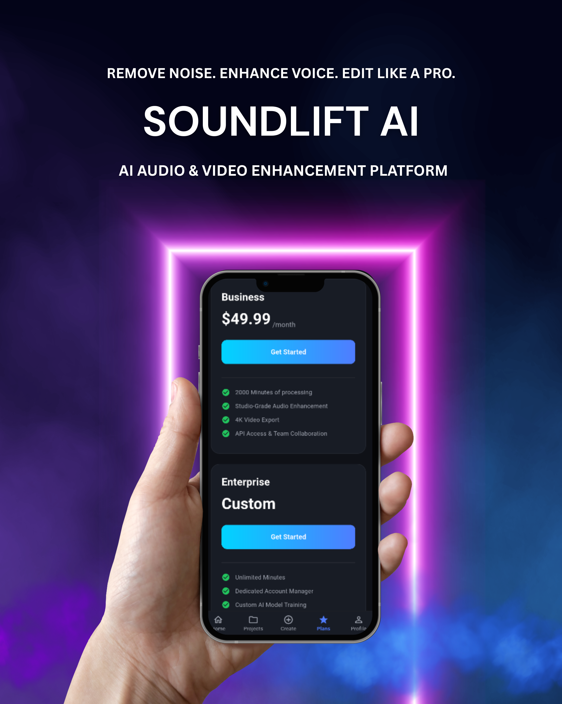

<div align="center">

# 🎧 SoundLift AI

### AI Audio & Video Enhancement Platform

Remove background noise with **DeepFilterNet**, edit multi-clip videos, record voice-overs, and add copyright-free music, all from one mobile app.


**Built by [Nexa Core Digital Ltd.](#-about-the-company)** · Status: ✅ Complete, awaiting Google Play publication

</div>

---

## 📖 Overview

**SoundLift AI** is a mobile platform that cleans up audio and video using AI. Users upload a noisy recording, and a DeepFilterNet-powered backend removes background noise. A built-in video editor lets them merge multiple clips, add voice-overs, and use copyright-free background music.

> 🔒 The source repository is private because the app is signed and waiting for release on the Google Play Store under **Nexa Core Digital Ltd.** This repo is a public showcase of the project, its architecture, and its features.

---

## 📱 App Screens

> Replace the image paths below with your poster files.

| | | |
|:---:|:---:|:---:|
|  |  |  |
| **Onboarding** | **Sign in** | **Home** |
|  |  |  |
| **Noise Reduction** | **Video Editor** | **Voice-over** |
|  |  |  |
| **Music Library** | **My Projects** | **Subscription** |

*(Add or remove rows to match your posters, e.g. notifications, support, referrals, profile.)*

---

## ✨ Features

### 🔊 AI Noise Reduction
- Removes background noise from **audio and video** using **DeepFilterNet**
- Runs on the backend (PyTorch CPU build) as asynchronous Celery jobs
- Live progress updates over WebSockets

### 🎬 Video Editor
- Merge **multiple clips** into one video
- Record or import **voice-overs**
- **Copyright-free background music** library
- On-device media processing with FFmpeg

### 🔐 Authentication & Security
- JWT authentication with short-lived access tokens and refresh-token rotation and blacklisting
- **Google Sign-In**
- **Two-step verification**
- HTTPS enforcement, secure cookies, and HSTS in production
- File type validation on uploads

### 💳 Payments & Subscriptions
- **Stripe** integration for subscriptions (currently in sandbox mode, moving to live payments at launch)
- Scheduled Celery jobs for subscription expiry checks and expiry warning emails
- Billing history and referral system

### 🔔 Real-time & Communication
- WebSocket notifications (Django Channels + Redis) with JWT-authenticated connections
- Transactional emails via the Gmail API
- In-app support module

### 📦 Storage
- User media stored on **AWS S3**

---

## 🏗️ Architecture

```
┌──────────────────┐        HTTPS / REST         ┌─────────────────────────┐
│  Flutter App     │ ──────────────────────────▶ │  Django + DRF (Daphne)  │
│  (Dart)          │ ◀────────────────────────── │  JWT · Stripe webhooks  │
│                  │        WebSocket (ASGI)      └───────────┬─────────────┘
└──────────────────┘                                          │
                                       ┌──────────────────────┼──────────────────────┐
                                       ▼                      ▼                      ▼
                               ┌──────────────┐      ┌────────────────┐      ┌──────────────┐
                               │ PostgreSQL   │      │ Redis          │      │ AWS S3       │
                               │ (data)       │      │ broker + WS    │      │ (media files)│
                               └──────────────┘      └───────┬────────┘      └──────────────┘
                                                             ▼
                                                    ┌──────────────────┐
                                                    │ Celery Workers   │
                                                    │ DeepFilterNet    │
                                                    │ FFmpeg           │
                                                    └──────────────────┘
```

Both the API and the workers are containerized with **Docker** and hosted on **Railway**.

---

## 🧰 Tech Stack

### Backend
| Area | Technology |
|---|---|
| Framework | Django 4.2, Django REST Framework |
| Server | Daphne (ASGI) / Gunicorn |
| Database | PostgreSQL |
| Cache / Broker | Redis |
| Background tasks | Celery + Celery Beat |
| Real-time | Django Channels, `channels-redis` |
| Auth | SimpleJWT (with blacklist), Google Sign-In, 2-step verification |
| AI / Audio | DeepFilterNet, PyTorch, torchaudio, ffmpeg-python |
| Payments | Stripe |
| Storage | AWS S3 (`django-storages`, `boto3`) |
| Static files | WhiteNoise |
| Email | Gmail API |
| PDFs | ReportLab |
| DevOps | Docker, Railway |

### Frontend (Flutter / Dart)
| Area | Package |
|---|---|
| State management | `flutter_riverpod` |
| Routing | `go_router` |
| Networking | `dio`, `web_socket_channel` |
| Local storage | `hive`, `shared_preferences` |
| Media | `video_player`, `just_audio`, `ffmpeg_kit_flutter_new` |
| Files | `file_picker`, `path_provider` |
| Auth | `google_sign_in` |
| Payments | `flutter_stripe` |
| Monetization | `google_mobile_ads` |
| Other | `url_launcher`, `youtube_player_flutter`, `flutter_inappwebview` |

---

## 📂 Backend Modules

| App | Responsibility |
|---|---|
| `accounts` | Users, authentication, Google Sign-In, 2-step verification |
| `projects` | Audio/video projects, uploads, processing jobs |
| `notifications` | Real-time WebSocket and push-style notifications |
| `subscriptions` | Plans, entitlements, expiry checks |
| `billing` | Stripe checkout, webhooks, invoices |
| `referrals` | Invite and reward system |
| `support` | User support tickets |

---

## 🚀 Project Status

- [x] Backend API deployed on Railway
- [x] Flutter app completed
- [x] Stripe integrated (sandbox)
- [x] App signed for Google Play
- [ ] Stripe live mode
- [ ] Google Play Store release by Nexa Core Digital Ltd.

---

## 🏢 About the Company

**Nexa Core Digital Ltd.** is the publisher of SoundLift AI. The source code is kept private until the official release.

---

## 👨‍💻 Author

**Mahfuz Alam Chowdhury**
Software Engineer · CSE Graduate
Python/Django · Flutter · AI Integration
📍 Sylhet, Bangladesh

- 🌐 GitHub: [github.com/mahfuzalam25](https://github.com/mahfuzalam25)
- 💼 LinkedIn: [linkedin.com/in/md-mahfuz-alam-chowdhury](https://www.linkedin.com/in/md-mahfuz-alam-chowdhury)
- 📧 Email: [mahfuzalam.chowdhury.se@gmail.com](mailto:mahfuzalam.chowdhury.se@gmail.com)
- 🏢 Portfolio: [mahfuzalam25.pythonanywhere.com](https://mahfuzalam25.pythonanywhere.com/)

---

<div align="center">

© 2026 Nexa Core Digital Ltd. All rights reserved.
This repository is a showcase only. The source code is proprietary and not licensed for reuse.

</div>